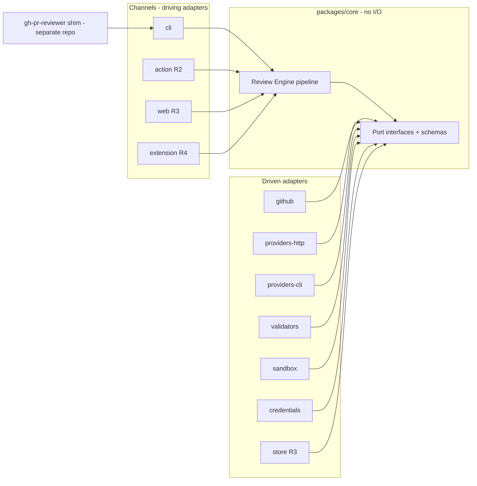
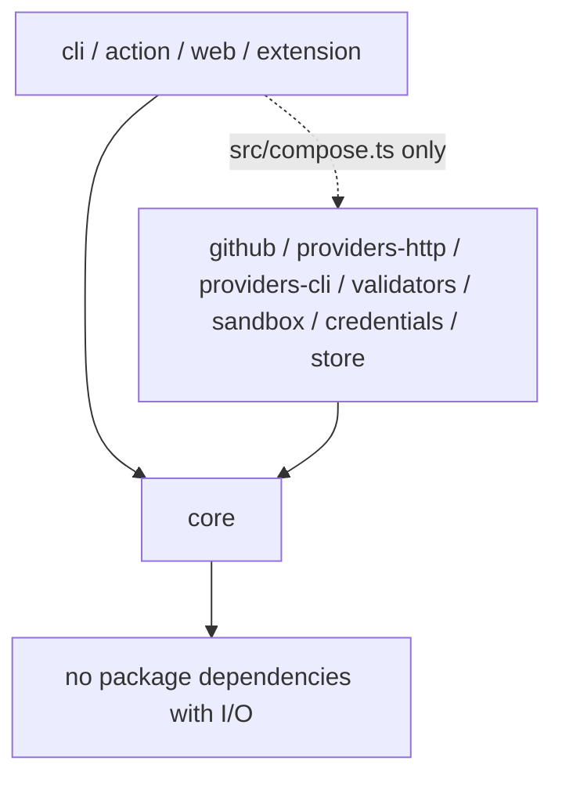
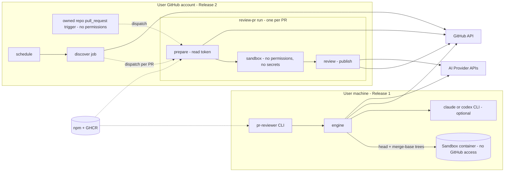

# Architecture Spine — PR Reviewer

Terms (Review Engine, Channel, Review Run, Finding, Report, Layer Status, Overall Status, Coverage, Mandatory Layer, AI Provider, Credential, Configuration, Watch Scope, Sandbox, Publish) are used exactly as defined in the PRD §3 Glossary. "Channel profile" means a named user profile (AD-13). `H(x)` is the canonical hash of AD-12.

## Design Paradigm

**Hexagonal (ports & adapters)** with the Review Engine as a **pipes-and-filters** pipeline at its centre.

- **Core** (`packages/core`): the pipeline, schemas, gate, hashing, fingerprinting, renderers, and the port interfaces (AD-25). No I/O.
- **Driven adapters** implement core ports: `github`, `providers-http`, `providers-cli`, `validators`, `sandbox`, `credentials`, `store` (Release 3).
- **Driving adapters** are the Channels: `cli`, `action` (Release 2), `web` (Release 3), `extension` (Release 4). Each has one composition root, `src/compose.ts`, that wires adapters into the engine. The `gh` extension is a shim in a separate repository (AD-21).



## Invariants & Rules

### AD-1 — Core is I/O-free; the isomorphic set runs anywhere

- **Binds:** `core`, `github`, `providers-http`, `validators`; FR-6a, FR-36, FR-37, NFR-7, NFR-8.
- **Prevents:** a Node-only or effectful engine that can't run in the browser extension or be tested deterministically; Standalone mode that can't run secret scanning.
- **Rule:** the **isomorphic set** is `core`, `github`, `providers-http`, and `validators`. It imports no Node built-ins and never reads `process` or env; the only globals it uses are `fetch` (adapters only, never `core`), `crypto.subtle`, `TextEncoder`/`TextDecoder`, `URL`, and `AbortController`. `core` gets time, logging, caching, and events only through ports (AD-25). No runtime code generation anywhere in the set: `core` calls `z.config({ jitless: true })` at module init and never calls `z.compile()`. `core`'s `dependencies` are a CI-checked allow-list (`zod` only), and its tsconfig keeps `types: []`. Enforced by `scripts/check-boundaries.mjs` (no TypeScript-API dependency) and by one test that loads the whole set under a CSP without `unsafe-eval`.

### AD-2 — Dependency direction

- **Binds:** all packages.
- **Prevents:** cycles, adapters coupling to each other, Channels bypassing the engine.
- **Rule:** dependencies point inward only, as drawn below. An adapter imports only `core`, never another adapter. A Channel imports adapters only in `src/compose.ts` and reaches review behaviour only through core's public API (AD-3). Enforced by `scripts/check-boundaries.mjs`.



### AD-3 — One fixed pipeline; only the gate decides status

- **Binds:** Review Engine; FR-2..FR-8, FR-6b, FR-19, NFR-8.
- **Prevents:** Channels assembling different Reports from the same inputs; AI calls before redaction; ad-hoc status logic.
- **Rule:** every Review Run executes these stages in order, each taking and returning an immutable `RunContext`:
  `resolveUserConfig → fetchPrMeta → resolveRepoConfig → fetchContext → detect → plan → execute → redact → review → normalize → dedupe → gate → assemble`; `publish` is a separate call (AD-23).
  - `execute` runs every non-AI Validator (file-only, Sandbox, external-result reuse; secret scanning always) in parallel under per-Validator timeouts and a concurrency limit.
  - `redact` replaces every detected secret span in PR content and Finding evidence. `AiReviewRequest` is constructible only from the redacted context (type-enforced). If the `SECRETS` layer did not execute (AD-24), `review` does not run and `AI_REVIEW` is `SKIPPED` with `SECRET_SCAN_UNAVAILABLE`.
  - `review` is the only stage that calls `ProviderPort`; its input is the redacted context plus the deterministic Findings.
  - Only `gate` computes Overall Status, layer summary, and coverage. Cancellation (user abort, head moved before `gate`, repository opted out) is a `gate` input, `ctx.cancelled`, that yields `CANCELLED`; the controller still runs `gate` and `assemble` on cancellation.
  - Core exports only `runReview`, `planPublish`, `renderPublish`, `publish`, the renderers, the hash functions, and the schemas. Stage functions are not exported, so a Channel may stop after `assemble` but cannot skip, reorder, or replace a stage.

### AD-4 — Schemas live in core and are the only shape

- **Binds:** Configuration, Finding, Report, ValidatorResult, AiReviewRequest/AiReviewResponse, SandboxPlan, PublishPlan/PublishRecord, RunEvent, ReviewService v1; FR-8, FR-24, FR-32.
- **Prevents:** CLI JSON, Web App, extension, and Validators drifting into different shapes.
- **Rule:** each shape is defined once as a runtime schema in `core`; TypeScript types are inferred from it and JSON Schema (draft 2020-12) is generated from it and published with each release. Every persisted or transmitted artefact carries `schemaVersion`, evolved per AD-22. Anything crossing a port boundary (Validator output, Sandbox output, AI output, repo config, cache values, markers) is size-capped and parsed with its schema before use. An envelope that fails to parse is Layer Status `ERROR` with `SCHEMA_INVALID`; item-level handling is in AD-8 and AD-13.

### AD-5 — Validator contract

- **Binds:** `packages/validators`, Sandbox; FR-3, FR-4, FR-39, FR-40, NFR-7.
- **Prevents:** Validators doing their own I/O, inventing statuses or classifications, running a tool twice, or running PR code outside a Sandbox.
- **Rule:** a Validator is `{ id, version, tool, layers: LayerId[], supports(ctx), needsSandbox, baseline, hermetic, inputs(ctx), sandboxSteps?(ctx), run(ctx, ports) → ValidatorResult }`, registered in the core registry.
  - It reads repository content only through `ctx.files` (AD-6).
  - `needsSandbox: true` for any Validator that invokes a tool resolving configuration, plugins, or dependencies from the repository; only product-owned parsers and scanners are `false`. Sandbox Validators declare their commands in `sandboxSteps` at `plan` and parse the step results on the host in `run`, as untrusted input (AD-7).
  - `plan` selects at most one Validator per (project, tool), the most specific, and records the others as `NOT_APPLICABLE` with `SUPERSEDED_BY_VALIDATOR`.
  - `SKIPPED` with `NO_SANDBOX` only when `plan` found no Sandbox capability; a planned Sandbox step with no valid output is `ERROR` (`SANDBOX_OUTPUT_INVALID`) or `TIMEOUT`.
  - Statuses are the seven Layer Statuses only, with a `ReasonCode` (AD-24) for anything other than `PASSED`, `WARNING`, `FAILED`. A tool crash is `ERROR`; a problem in the PR is a Finding. Validators never set `scope`, `fingerprint`, `disposition`, or `ruleId` for AI (core does, AD-12, AD-15).

### AD-6 — Context retrieval split

- **Binds:** `fetchContext`, Sandbox; FR-2, FR-39, FR-40. Resolves PRD OQ-8 (clone vs API-only).
- **Prevents:** laptop runs needing a clone, credentials near untrusted code, and reads from a moving ref.
- **Rule:** all PR context (metadata, diff, base and head file contents, reviews, comments, reactions, check results) comes from the GitHub API through `GitHubReader`, pinned to `run.baseSha`, `run.headSha`, and `run.mergeBaseSha` (from the compare API), never a branch ref. Validators read files only through `ctx.files: FileAccessor{list(side), read(path, side)}`, memoised per run. Source for the Sandbox is materialised by trusted code: `GitHubReader` downloads the head and merge-base source archives at exact SHAs, and the engine hands the extracted trees to `SandboxPort`. No git clone exists anywhere.

### AD-7 — Sandbox boundary

- **Binds:** `packages/sandbox`, Auto-Review workflow (R2), Web App runs (R3); FR-39, FR-40, NFR-1.
- **Prevents:** PR code reaching Credentials, tokens, GitHub, or trusted caches; local and Actions Sandboxes behaving differently.
- **Rule:**
  - The Sandbox is an ephemeral container (Docker or Podman, auto-detected, Docker preferred on runners; `--rm`) from the toolchain image pinned by digest (AD-21). It never holds a credential, a `.git` remote, host env, the container socket, or network access to GitHub hosts. Mounts: head and merge-base trees read-only, a writable copy, and a scratch dir.
  - Contract: `SandboxPort.run(step{phase: INSTALL|ANALYZE, cmd, cwd, timeoutMs}) → {exitCode, stdout, stderr, files}`, size-capped; all parsing happens on the host (AD-5). `SandboxPlan` is a run's ordered steps; `planHash = H(SandboxPlan)`. Every result carries `{planHash, headSha, imageDigest}` and is rejected on any mismatch.
  - `INSTALL`: egress default-deny except `sandbox.registries` (default `registry.npmjs.org`); if that allow-list cannot be established, install does not run and dependent layers are `SKIPPED` with `NO_EGRESS_CONTROL`. `ANALYZE`: `--network none`. One conformance test asserts a non-registry host is unreachable during install, locally and in Actions.
  - The Node major is taken from `.nvmrc`, then `.node-version`, then `engines.node`, among the image's pinned `nodeMajors`; no match gives `SKIPPED` with `UNSUPPORTED_RUNTIME`. Tools come from the repo's devDependencies; the image's pinned tools and named default rulesets apply only when the repo has none, and the Report names them.
  - No `CachePort` inside the Sandbox. Auto-Review job topology: AD-14.

### AD-8 — AI calls are single, structured, tool-less

- **Binds:** `providers-http`, `providers-cli`, core `review`; FR-6, FR-6a, FR-6b, FR-9, FR-9a, FR-10, FR-11, FR-14.
- **Prevents:** agentic behaviour, provider-specific Finding shapes, unstable AI rule ids, and secrets or prompt-injected instructions acting through the AI.
- **Rule:** `ProviderPort.complete(AiReviewRequest) → AiReviewResponse{summary, findings: AiFinding[], rulesChecklist[{ruleId, source, status, note?}], injectionSuspected}`, one request per call. `AiFinding` is a core schema subset without `id`, `ruleId`, `fingerprint`, `commitSha`, `scope`, `disposition`, or `provenance`, which core fills; its `category` comes from the closed catalogue (AD-15). Structured output uses the vendor's native JSON-schema output or a single forced, side-effect-free schema tool; no other tool is ever declared. `AiReviewRequest` carries `userRules[]` and `repoRules[]` separately; one versioned core prompt template puts PR content and `repoRules` inside per-run random-nonce delimiters as untrusted data, and a user rule wins over a conflicting repo rule. HTTP adapters (`providers-http`): `anthropic` (configurable `baseUrl`, covering Anthropic-compatible endpoints) and `openai-compatible` (covers OpenAI, OpenRouter, Ollama, Azure OpenAI, and FR-9a custom endpoints). CLI adapters (`providers-cli`): `claude-code`, `codex` — they spawn the vendor's own binary in a fresh empty temp directory (outside any git repository) with all tools disabled, project settings, hooks, MCP servers, and agent instruction files not loaded, a minimal environment with no GitHub or other Credentials (the vendor's own login store stays reachable), the request on stdin, and schema-constrained JSON output (each adapter derives a provider-compatible schema from the canonical one; `core` always re-validates against the canonical one). Claude Code runs in safe mode with no tools, no MCP, and no session persistence (bare mode is not used because it ignores subscription login); Codex runs with user config, rules, web search, shell, and every optional tool disabled, and a dedicated `CODEX_HOME` holding only its login. Each CLI adapter runs a start-up self-test that structured output comes back and refuses vendor CLI versions that lack the isolation flags it relies on. The only exception to the Credential-free environment is the Auto-Review subscription opt-in (PRD FR-10), where exactly the vendor's own CLI token variable is passed. Each adapter declares the Channels it is allowed in (PRD FR-10 matrix); the engine refuses a provider outside its Channels.
  - **Fallback:** the provider order is held in core and advances only on retryable `AppError`s (rate limit, 5xx, timeout, CLI missing or logged out), never on schema failures, and skips refused providers. Every attempt is recorded in `Report.ai.attempts[]`.
  - **Validation:** a response envelope that fails its schema makes `AI_REVIEW` `ERROR` (`SCHEMA_INVALID`). An individual Finding that fails its schema or grounding (path not in the Head Commit) is dropped and counted in `ai.droppedFindings`; if more than half are dropped, the layer is `ERROR`. Placement (inline, file-level, summary) is decided by AD-9. AI output never sets a verdict or status.

### AD-9 — Single writer to GitHub

- **Binds:** `publish`, `GitHubWriter`; FR-6a, FR-17..FR-21.
- **Prevents:** side-channel posts from Validators, providers, or Sandbox output; approvals; comments that fail the whole review.
- **Rule:** only core `publish` writes to GitHub, through `GitHubWriter`; everything else receives `GitHubReader` or nothing. `GitHubWriter` accepts review events `COMMENT`, `REQUEST_CHANGES`, and pending only, and has no approve, merge, or branch-protection operation; Auto-Review never sends `REQUEST_CHANGES`. Inline comments attach only to right-side lines inside the PR's diff hunks (the mapping kept from `review.mjs`); a Finding on another line of a changed file becomes a file-level comment, anything else goes in the summary, and one bad anchor never fails the whole review. Published text is sanitised (mentions neutralised, links allow-listed from user config, HTML stripped) **before** the hidden marker is appended. Every summary ends with a disclosure line naming the product, the provider(s) and model(s) from `ai.attempts`, and whether it was published unattended. Every REST call pins `X-GitHub-Api-Version` (Stack). Publish mechanics: AD-23.

### AD-10 — Credentials are references, values are opaque

- **Binds:** `packages/credentials`, Configuration, logging; FR-15, FR-16a, NFR-2.
- **Prevents:** Credential values in Configuration, Reports, logs, prompts, or Sandbox; Channels reading different variables.
- **Rule:** Configuration holds named references (`github`, `provider:<id>`), never values. `CredentialPort` resolves them into a `Secret` whose string and JSON forms are redacted; the raw value is read only inside the adapter that sends it, and the logger redacts every resolved value. Precedence per reference, first hit wins:
  - `github`: `GITHUB_TOKEN`, `GH_TOKEN`, OS keychain, `gh auth token --hostname <configured host>`.
  - `provider:anthropic`: `ANTHROPIC_API_KEY`, keychain. `provider:openai`: `OPENAI_API_KEY`, keychain. Custom providers name their env var in user config.
  - Legacy `GH_REVIEW_TOKEN` is accepted only by the migrated workflow (AD-20). Generated Auto-Review workflows set `GH_TOKEN` from the automation secret and never set `GITHUB_TOKEN`.
  - The keychain is accessed through a maintained N-API library. With no keychain, setup stores nothing and tells the user to use env vars; Credentials are never written to a plain file.

### AD-11 — Idempotency and self-recognition by marker

- **Binds:** `publish`, Auto-Review discovery, CLI `list`; FR-19, FR-20a, FR-20b, FR-25, PRD OQ-4.
- **Prevents:** duplicate reviews, forged markers suppressing reviews, editing other people's comments, version skew rewriting or re-posting.
- **Rule:**
  - Marker (appended after sanitising): `<!-- pr-reviewer mv=1 kind=<summary|review|inline> rid=<reviewerId> head=<headSha> cfg=<configHash> eng=<engineMajor> fpv=<fingerprintAlgoVersion> key=<idempotencyKey> fp=<fingerprint or -> u=<in>/<out>/<costMicros> -->`. Summary markers also carry `fps=` (comma list of 16-hex fingerprint prefixes of Findings listed only in the summary). The literal `pr-reviewer` is fixed and does not follow a product rename.
  - `rid` is the Reviewer Identity's numeric GitHub user id (`GitHubReader.viewer()`). `idempotencyKey = H({host, repoId, pr, headSha, configHash, engineMajor, rid})`.
  - **Own output** = a well-formed marker **and** author id equal to this run's `rid` **and** marker `rid` equal to the same. Markers on anything else are ignored for skip, update, and resolve decisions, never edited, and counted in `audit.foreignMarkers`. Users review independently (OQ-4).
  - **Run identity** is `key`: an own `kind=review` marker with an equal key means the review is skipped. **Summary identity** is `(rid, repoId, pr)`: at most one live summary, edited in place whatever its `head` or `cfg`.
  - **Versions:** markers with an unknown `mv` are ignored entirely; fingerprints are compared only between equal `fpv` (others are neither re-posted against nor listed as resolved); an engine never rewrites a summary whose `eng` is newer than its own major, and then publishes nothing (`SKIPPED_NEWER_ENGINE`).
  - Prior Findings for anything written to GitHub come only from own markers (`fp`, `fps`); Channel-local history is display-only.
  - **Dismissals (FR-20b):** a 👎 reaction, or a reply whose first word is `/dismiss`, on an own inline comment, read in `fetchContext`. `dedupe` marks matching Findings `dismissed`, and they are not re-posted while their fingerprint is unchanged. Dismissals never change the gate, and a dismissal by the PR author never suppresses a `BLOCKER` or `CRITICAL` Finding.

### AD-12 — Canonical hashing, fingerprints, scope, and cache keys

- **Binds:** `normalize`, `dedupe`, caching, idempotency, incremental re-review; FR-4, FR-7, FR-19, NFR-8, NFR-11. Resolves PRD OQ-8 (fingerprinting, "unchanged inputs").
- **Prevents:** Channels and platforms computing different keys; duplicate Findings across line shifts and Validators; each Validator classifying new code its own way; stale cache reuse.
- **Rule:**
  - `H(x)` = lowercase-hex sha256 (via `crypto.subtle`) of the RFC 8785 canonical JSON of a named object, never positional concatenation. Inputs are normalised: repository as numeric `repoId` plus lower-cased `full_name`, paths as NFC repo-relative POSIX, text with LF line endings. Only `core` computes `configHash`, `idempotencyKey`, `fingerprint`, and `planHash`; a cross-platform golden-vector test pins them.
  - `configHash = H(projection of the resolved Configuration onto keys the core schema marks affectsReview)`. Keys at their product default are omitted from the projection. Output paths, log level, colour, progress, publish options, Credential references, and Channel are not `affectsReview`.
  - `fingerprint = H({fpv, ruleId, path, anchorKind, anchor, sourceFamily, ordinal})`: `anchor` is the whitespace-collapsed anchored lines of the Finding's side for `LINE`, `@file` for `FILE`, `@pr` for `PR`; `ordinal` is the occurrence index among Findings equal on every other field, ordered by start line. Line numbers are never included. A merged Finding keeps `fingerprints[]`; `Finding.id` is its strongest member's fingerprint; cross-run and cross-Channel matching (resolved, dismissed, history) is by non-empty intersection of `fingerprints[]`, never by `id`.
  - `dedupe` merges equal fingerprints; across source families it merges only on equal `category`, overlapping range, and a `core/rule-map` entry linking the deterministic `ruleId` to that category. Same line alone never merges. Deterministic evidence beats AI.
  - **Scope:** only `normalize` assigns `scope`, with one base-vs-head algorithm. Validators with `baseline: true` also run on the merge-base tree. A Finding "touches the change" if its `LINE` anchor intersects added or modified head lines, its `FILE` anchor is a changed file, or it is `PR`-anchored. `NEW` = touches the change and no base Finding shares a fingerprint; `WORSENED` = a base match exists with lower severity or fewer occurrences; `PRE_EXISTING` = any other base match, or (without a baseline) does not touch the change; `UNKNOWN` = cannot be located in the Head Commit. The gate counts `NEW`, `WORSENED`, and `UNKNOWN`.
  - **Cache keys:** Validator key = `H({validator id and version, tool version or image digest for Sandbox Validators, the configuration projection it reads, inputs})`, where `inputs` is the blob SHAs of its declared files only if `hermetic: true`, otherwise the head tree SHA plus lockfile blob SHAs. AI key = `H({provider, model, prompt-template version, redacted request})`. Reuse only on exact match; the gate always evaluates the whole PR. Placement: AD-26.

### AD-13 — Configuration resolution

- **Binds:** `resolveUserConfig`, `resolveRepoConfig`; FR-1, FR-13, FR-14, FR-27. Resolves PRD OQ-6.
- **Prevents:** a repository redirecting Credentials or data, PRs disabling their own checks, config read from a moving branch, a pinned automation silently dropping safety settings, hardcoded values.
- **Rule:**
  - Order: product defaults → user config (base, then the Channel's named profile) → repo config → per-run overrides. `resolveRepoConfig` reads `.github/pr-reviewer.yml` at exactly `pr.base.sha` from `fetchPrMeta` and records it as `run.repoConfigSha`; include/exclude paths and limits apply from `fetchContext` on. Each resolved key records its source layer in `audit.configSources`.
  - **User config:** one `UserConfig` schema with `profiles` keyed by name (`cli`, `auto-review`, `web`, `extension`); each Channel applies only its own profile. Location per Channel: CLI `$XDG_CONFIG_HOME/pr-reviewer/config.yml`, falling back to `~/.config/pr-reviewer/config.yml` (`%APPDATA%\pr-reviewer\config.yml` on Windows); Auto-Review `.pr-reviewer/config.yml` in the automation repo, written by setup, no secrets; Web App its store; extension one `chrome.storage.local` key. Unknown keys or a newer `version` in user config end the run `ERROR` with `CONFIG_UNSUPPORTED` (fail closed).
  - **Repo config:** YAML `version: 1`, a strict allow-list: Review Rules, include/exclude paths, thresholds, comment limits, extra Validators, and `automatedReview: false` (can only reduce review; AD-14). Forbidden or unknown keys are ignored and reported; an unparseable file is treated as absent with a Report warning.
  - `UserConfig.locked` is a list of JSON Pointers; repo values at locked paths are ignored and reported. Mandatory Layers (default `CONTEXT` and `SECRETS`) come only from user config and are always locked.
  - **Review Rules:** Markdown; repo rules from `.github/pr-reviewer/rules/*.md` at `pr.base.sha`; user rules from `rules.global[]`, `rules.orgs`, `rules.repos` entries as file paths or HTTPS URLs fetched through `RulesSource`. An unreachable rule source is a Report warning.
  - YAML is parsed with the YAML 1.2 core schema. Product defaults contain no hosts, repos, orgs, or URLs beyond the public GitHub API default, which is overridable.

### AD-14 — Auto-Review topology; GitHub is the store

- **Binds:** `packages/action` (R2); FR-26..FR-29a. Resolves PRD OQ-8 (state location, public vs private).
- **Prevents:** a state file diverging from reality; PR data in automation logs or state; credentials or runner tokens reaching PR code; cross-PR result forgery; blowing the free CI allowance; `pull_request_target` exposure.
- **Rule:**
  - The automation lives in a **private** repository created by setup in the user's account. Each scheduled run has one `discover` job (user read token, `actions: write`): it searches the Watch Scope, reads `automatedReview` from each candidate repo's default branch at most once per run, reads own markers (AD-11) to skip reviewed Head Commits, and dispatches `review-pr.yml` once per PR with `{repo, pr, headSha}`. There is no cross-PR matrix.
  - `review-pr.yml` is one workflow run per PR, with `concurrency: {group: pr-<repoId>-<pr>, cancel-in-progress: false}`:
    1. `prepare` (read token): runs the engine to `plan` at the dispatched `headSha`, downloads the head and merge-base archives, outputs `SandboxPlan` and `{headSha, baseSha, mergeBaseSha}`, and uploads the trees as an artefact.
    2. `sandbox` (`permissions: {}`, no secrets): the pinned CLI executes the plan; PR code runs only inside `docker run` with no runner environment passed, so runner tokens never reach PR processes; container output never reaches the job log; results return as job outputs where ≤ 1 MB, otherwise as an artefact.
    3. `review` (user token, AI Credentials, `actions: write`): recomputes to `plan` pinned to `prepare`'s SHAs, requires `planHash` and `headSha` equality on every Sandbox result (else `ERROR` with `SANDBOX_OUTPUT_INVALID`), finishes the pipeline, and publishes.
    Sandbox layers are opt-in for Auto-Review; without them `review-pr.yml` is the single `review` job.
  - Artefacts use `retention-days: 1` and are deleted by an `if: always()` step at the end of the run. No `actions/cache`; caching is in-run only (AD-26). No PR content, Finding, or code goes to logs, step summaries, retained artefacts, or the repository; only statuses and counts are printed. The audit record for this Channel is the published summary plus run ids, SHAs, statuses, and usage.
  - **Budget:** setup estimates monthly job-minutes (scheduled `discover` runs plus expected PRs × jobs per PR, each job rounded up to a whole minute), picks the shortest interval in {30, 60, 120} minutes whose estimate is ≤ 60% of the account's free allowance (60 minutes on GitHub Free), and refuses any configuration estimated above 60%.
  - **Immediate review (FR-28):** on owned repos only, a workflow on `pull_request` (never `pull_request_target`) with `permissions: {}` that checks out nothing and only dispatches `{repo, pr, headSha}` to the automation repo, using a token limited to Actions write on the automation repo. Fork PRs fall back to scheduled discovery. `review-pr.yml` is also manually dispatchable for a single PR.
  - **Opt-out:** `discover` drops repos with `automatedReview: false`; the engine re-checks at `pr.base.sha` and cancels with `REPO_OPTED_OUT`, publishing nothing.
  - **Health (FR-29):** one issue per cause in the automation repo, marked `<!-- pr-reviewer health cause=<code> -->` with cause codes as a core enum, closed when the cause clears; issue bodies hold no PR content.

### AD-15 — Report and Finding shape

- **Binds:** `assemble`, all Channels, JSON output; FR-6, FR-8, FR-11, FR-12, FR-17, FR-24, FR-32, NFR-10. Resolves PRD OQ-8 (Report schema).
- **Prevents:** Channels inventing their own report fields, enum spellings, or status meanings; a Report changed after the gate.
- **Rule:**
  - **Report** (`schemaVersion` 1): `run{id (UUIDv7), idempotencyKey, host, repo{id, fullName}, pr, baseSha, headSha, mergeBaseSha, repoConfigSha, configHash, engineVersion, fpv, channel, startedAt, finishedAt}`, `overallStatus`, `layers[{layer, validator, status, reason?, tool?, toolVersion?, durationMs}]`, `layerSummary[]` and `coverage{ran[], notRun[], headline}` (AD-24), `technologies[{project, language, framework?, version?, confidence, evidence[]}]`, `summary`, `findings[]`, `resolvedFingerprints[]`, `limitations[]` (e.g. truncated files), `gate{result, failedRules[]}`, `ai{attempts[{provider, model, outcome, reason?, usage{input?, output?}, costEstimate?}], droppedFindings{schema, grounding}, partial}`, `rulesChecklist[]`, `audit{resolvedConfig (references only), configSources[], tools[], gateInputs, redactions, foreignMarkers}`. `channel ∈ CLI|AUTO_REVIEW|WEB|EXTENSION_STANDALONE|EXTENSION_CONNECTED`.
  - **Finding:** `{id, fingerprint, fingerprints[], ruleId, sourceFamily, category, severity, confidence, title, description, impact, recommendation, suggestedCode?, location{path?, side: HEAD|BASE, startLine?, endLine?, anchorKind: LINE|FILE|PR}, commitSha, scope, disposition: GATING|ADVISORY, dismissed?{by, byPrAuthor}, evidence[{type, details}], provenance{validator, tool, toolVersion, provider?, model?}, alsoReportedBy[], toolSeverity?, reusedFrom?, partial, references[]}`.
  - **Closed enums (core):** severity `BLOCKER|CRITICAL|MAJOR|MINOR|INFO`; confidence `HIGH|MEDIUM|LOW`; category `CORRECTNESS|SECURITY|SECRET|PERFORMANCE|MAINTAINABILITY|ARCHITECTURE|TESTS|ACCESSIBILITY|COMPATIBILITY|DEPENDENCY|BUILD|STYLE|PROMPT_INJECTION`; scope `NEW|WORSENED|PRE_EXISTING|UNKNOWN`; sourceFamily `DETERMINISTIC|EXTERNAL|AI`. The category list is the closed AI catalogue, versioned with the prompt template; core sets every AI `ruleId` to `ai/<category in lower case>`. Core sets `disposition: ADVISORY` for `LOW`-confidence AI Findings.
  - `assemble` sorts `findings[]` by (severity rank, disposition, path, startLine, fingerprint). The Report is immutable after `assemble`; publish results live in a separate `PublishRecord` (AD-23). Channels render only through core renderers (`renderMarkdown`, `renderPublish`).

### AD-16 — Channels are thin; one remote engine contract

- **Binds:** `cli`, `action`, `web`, `extension`, `gh-pr-reviewer`; FR-22..FR-38.
- **Prevents:** review logic forking per Channel; each backend inventing its own HTTP API or progress stream.
- **Rule:** a Channel owns I/O, UX, and `src/compose.ts`, nothing else. Core emits `RunEvent{runId, seq, at, type: STAGE_STARTED|STAGE_FINISHED|LAYER_STATUS|FINDING_COUNT|DONE, payload}` through `EventSink`, with `seq` monotonic per run; every progress UI renders from it. Remote engines (the Web App server and the CLI companion) implement one contract, `ReviewService v1`, generated from core schemas: `POST /v1/runs`, `GET /v1/runs/:id/events` (SSE of `RunEvent`, resumable via `Last-Event-ID`), `GET /v1/runs/:id/report`, `POST /v1/runs/:id/publish` (body: the user's choices `{event, include?, dryRun?, previewDigest?}`; the engine derives Reviewer Identity, hunks, and prior publication itself, a dry run returns the preview and its digest, and a publish whose re-rendered preview no longer matches the digest is refused with 409), plus `GET /v1/session` and `GET /v1/pulls?repo=`, bearer auth, `Accept-Schema` header (AD-22). Both pass one shared contract-test suite; the extension's Connected mode is a client of this contract only. The CLI companion (`pr-reviewer serve`, Channel `CLI`) binds `127.0.0.1` only, requires a ≥ 128-bit token (per launch for its own page; a pairing token stored through `CredentialPort` for the extension), and rejects requests whose Origin is not the paired extension or whose Host is not loopback. Standalone mode bundles exactly the isomorphic set (AD-1) and runs it in the side panel page, never in the MV3 service worker.

### AD-17 — Errors, logging, and status

- **Binds:** all packages; FR-4, NFR-4, NFR-10.
- **Prevents:** mixed error semantics and leaked data in logs.
- **Rule:** adapters return typed results; infrastructure failures become Layer Status `ERROR` or `TIMEOUT` with a `ReasonCode`, never Findings. Code never throws past a stage boundary except for programmer errors. Retry and backoff live in adapters, honouring `Retry-After` and GitHub secondary limits; exhausted retries give `ERROR` with `RATE_LIMITED`. Logs are structured JSON lines on stderr through the `Logger` port with redaction (AD-10); the API is `(eventId, fields)` where fields hold only ids, counts, enums, SHAs, and durations, and free text appears only at `debug`.

### AD-18 — Usage ledger for ceilings

- **Binds:** `review` stage, all Channels; FR-12.
- **Prevents:** Channels keeping incompatible spend counts, Auto-Review needing stored state, or storing PR data to count it.
- **Rule:** core checks the per-run and monthly ceilings through `UsageLedgerPort` (numbers only: UTC month, input and output tokens, cost in micros) before every AI call. On breach, `AI_REVIEW` is `SKIPPED` with `COST_CEILING`, `ai.partial` is true, and Findings so far are marked `partial`. Ledgers: CLI `$XDG_STATE_HOME/pr-reviewer/usage.json` (fallback `~/.local/state/pr-reviewer/usage.json`), counting every CLI run; Auto-Review sums `u=` over the user's own `kind=review` markers created this UTC month plus the current run, with no stored state; Web App its store, per user. A replaced pending review's `u` is added to its replacement's. The monthly ceiling applies per ledger.

### AD-19 — Network destinations

- **Binds:** all adapters; NFR-3, FR-6b, FR-14.
- **Prevents:** code or data reaching a destination the user didn't choose.
- **Rule:** the product connects only to: the configured GitHub API host, the chosen AI Provider endpoints, Review Rules URLs from user config, the configured vulnerability-advisory endpoint (through `AdvisoryPort`, sent package names and versions only), and package registries (Sandbox `INSTALL` phase only). The Sandbox never reaches GitHub. `Telemetry` is a port whose default implementation does nothing; v1 ships no telemetry endpoint. Dependency auditing is a file-only Validator that reads manifests and lockfiles.

### AD-20 — Brownfield disposition

- **Binds:** repository root; FR-1, FR-16a.
- **Prevents:** the old tool and the new one diverging, or repo-specific values surviving.
- **Rule:** `review.mjs`, `test.mjs`, the repo-specific rules file, and the manual workflow stay unchanged until the CLI reaches parity (Epic 2, Story 2.7), then are removed in that story; the manual workflow is replaced by one that runs the pinned CLI with the legacy `GH_REVIEW_TOKEN` secret mapped to `GH_TOKEN`. Kept and ported: diff-line mapping (AD-9), the untrusted-input stance (AD-8), never-approve (AD-9). Dropped: the AI's own verdict and risk fields (only `gate` decides). Mappings: severities `blocker→BLOCKER`, `major→MAJOR`, `minor→MINOR`, `nit→INFO`; the old skip list becomes default exclude paths; the context caps (60 KB per file, 350 KB context, 400 KB diff) become `limits.*` defaults, with truncation listed in `limitations[]`; `rules/default.md` becomes a user Review Rules entry. Test fixtures use placeholder owners. The replacement workflow writes no Findings to step summaries or retained artefacts.

### AD-21 — Release, distribution, and pinning

- **Binds:** all packages, the toolchain image, `gh-pr-reviewer`, generated Auto-Review workflows; FR-22, FR-26.
- **Prevents:** mixed package versions, an uninstallable `gh` extension, unpinned automation, and image drift between laptop and Actions.
- **Rule:** all `@pr-reviewer/*` packages and the toolchain image release in lockstep under one semver, which is `engineVersion`; `engineMajor` is its major. `@pr-reviewer/cli` (bin `pr-reviewer`) is the only public npm package: internal packages are bundled into it with esbuild (native modules such as the keychain library stay regular dependencies), and it is published with npm provenance. The generated JSON Schemas are published with each release. The toolchain image is multi-arch (amd64, arm64), published to GHCR, and referenced only by the digest recorded in the CLI release. The `gh` extension is a separate `gh-pr-reviewer` repository containing only a shim that runs the pinned `@pr-reviewer/cli`. Generated Auto-Review workflows pin `@pr-reviewer/cli` by exact version, the image by digest, the vendor CLIs by exact version, and every action by commit SHA; they change only through `pr-reviewer auto upgrade`, which bumps the pin and `.pr-reviewer/config.yml` in one commit. Setup refuses to write a config the pinned version cannot read. Changing the marker grammar, the fingerprint algorithm, or the `affectsReview` status of an existing key requires a new engine major.

### AD-22 — Schema, config, and marker evolution

- **Binds:** every core schema, user and repo config, markers, `ReviewService`; FR-24, FR-26, FR-32.
- **Prevents:** consumers on different release clocks failing or misreading each other's data; an unknown value displayed as passing.
- **Rule:** `schemaVersion` (Report, Finding, RunEvent, ReviewService), config `version`, marker `mv`, and `fpv` are independent integers owned by `core` and recorded in the Report. Within a version, writers only add optional fields; adding an enum value, removing or renaming a field, or changing a meaning bumps it. Readers parse with unknown-key passthrough (never strict), except user config (fail closed, AD-13) and repo config (allow-list, AD-13). Every enum has a reader-only `UNKNOWN`, to which unknown values map; `UNKNOWN` never counts as passing for a status, layer, or scope. Report readers accept the current and previous `schemaVersion` through core `upcast()`; persisted Reports are never rewritten; a newer version is a typed `SCHEMA_UNSUPPORTED` error. User config: older versions migrate in memory, newer ones end the run `ERROR`. Repo config: a newer version is treated as absent with a warning. Markers: AD-11.

### AD-23 — Publish contract

- **Binds:** core `publish`, `GitHubWriter`, every Channel that publishes; FR-2, FR-17..FR-21, FR-23, FR-33, FR-38.
- **Prevents:** preview differing from what is posted, Report mutation, stale-head posts, duplicate or partial reviews, destroying a user's draft review.
- **Rule:**
  - `planPublish(report, config) → PublishPlan{include (fingerprints or ALL_ELIGIBLE), edits, event, pending, maxInline}` and `renderPublish(report, plan) → PublishPreview` are pure core functions; `publish(report, plan, ports) → PublishRecord{status: PUBLISHED|SKIPPED_DUPLICATE|CANCELLED|SKIPPED_NEWER_ENGINE|BLOCKED_PENDING_DRAFT|FAILED, reason?, reviewUrl?, summaryUrl?, pending, commentCount, at}`. Every preview shows `PublishPreview`, and `publish` posts exactly its sanitised content. The Report is never mutated; the summary states the gate's Overall Status unchanged, plus a count of withheld Findings when the plan excludes any.
  - Immediately before writing, `publish` re-reads the PR head and own markers. A head other than `run.headSha` → writes nothing, `CANCELLED` with `SUPERSEDED`. An own `kind=review` marker with the same key → the review is skipped (`SKIPPED_DUPLICATE`) but the summary is still converged.
  - **Non-pending:** each Head Commit gets ONE `createReview` call carrying all its inline comments and the `kind=review` marker (atomic; the skip check reads only this marker; body is a one-line pointer to the summary). Then the summary, ONE marked issue comment per `(rid, repoId, pr)`, is created or edited in place; if more than one own summary exists, the oldest is kept and the rest deleted.
  - **Pending (FR-20a):** no issue comment; the summary is the pending review's body. The pending slot: none → create; ours with every comment ours → replace it with one carrying all current eligible Findings; anything else → write nothing, `BLOCKED_PENDING_DRAFT` (Auto-Review reports it through FR-29). The product never submits a pending review.
  - Inline comments are capped at `maxInline` in Report order (AD-15); the rest go in the summary. In Auto-Review, the per-PR concurrency group (AD-14) serialises publishers.

### AD-24 — Layer catalogue and aggregation

- **Binds:** core `gate`, `validators`, all renderers; FR-4, FR-5, NFR-4, Mandatory Layers.
- **Prevents:** different layer spellings, Channels aggregating layer status differently, and a layer shown `PASSED` while the gate says `INCOMPLETE`.
- **Rule:** `LayerId` is a closed core enum: `CONTEXT, SYNTAX, COMPILE, LINT, FRAMEWORK, STATIC_ANALYSIS, MAINTAINABILITY, PERFORMANCE, SECRETS, SECURITY, DEPENDENCIES, CORRECTNESS, ARCHITECTURE, TESTS, ACCESSIBILITY, COMPATIBILITY, EXTERNAL_RESULTS, AI_REVIEW` (Validation Capability Spec L1–L14, with secrets and dependencies split out, plus `CONTEXT` and `EXTERNAL_RESULTS`). `fetchContext` reports `CONTEXT` as a layer row. Reused CI results report into the layer `core/rule-map` maps them to, else `EXTERNAL_RESULTS`. Several Validators on one layer combine by worst status: `ERROR > TIMEOUT > FAILED > WARNING > SKIPPED > PASSED > NOT_APPLICABLE`. A layer counts as executed only if its combined status is `PASSED`, `WARNING`, or `FAILED`; a Mandatory Layer that did not execute makes the Overall Status `INCOMPLETE`. Only `gate` computes `layerSummary[{layer, status, reason?}]` and `coverage`; renderers print them and never aggregate. `ReasonCode` is a closed enum with an optional `detail`: `NO_SANDBOX, UNSUPPORTED_RUNTIME, NO_EGRESS_CONTROL, NOT_SUPPORTED, DISABLED_BY_CONFIG, SUPERSEDED_BY_VALIDATOR, SECRET_SCAN_UNAVAILABLE, COST_CEILING, PROVIDER_UNAVAILABLE, RATE_LIMITED, SANDBOX_OUTPUT_INVALID, SCHEMA_INVALID, TOOL_CRASHED, TIME_LIMIT, CONFIG_UNSUPPORTED, REPO_OPTED_OUT, SUPERSEDED, USER_ABORT, UNKNOWN`.

### AD-25 — Port inventory

- **Binds:** `core`, every adapter, every composition root; NFR-7.
- **Prevents:** builders inventing ad-hoc ports or importing effects into core.
- **Rule:** core defines exactly these ports, and every call takes an `AbortSignal`: `GitHubReader`, `GitHubWriter` (handed only to `publish`), `ProviderPort`, `SandboxPort`, `CredentialPort`, `CachePort`, `UsageLedgerPort`, `Clock` (now, sleep, timeout), `Logger`, `EventSink`, `RulesSource`, `AdvisoryPort`, `Telemetry` (no-op default), and `StorePort` (Release 3). Hashing uses `crypto.subtle` directly (Node ≥ 22 and browsers), not a port. Adding a port is a spine change.

### AD-26 — Caching

- **Binds:** `CachePort` implementations, all Channels, Sandbox; NFR-11, FR-19, FR-39.
- **Prevents:** cache poisoning across users, repos, or PRs; Findings persisting in Auto-Review; untrusted cache values reaching the gate.
- **Rule:** `CachePort` values are untrusted and re-parsed with their schema on read; keys are prefixed `H({rid, repoId})`; only the engine writes entries, from schema-validated results. CLI: `$XDG_CACHE_HOME/pr-reviewer/` (fallback `~/.cache/pr-reviewer/`), LRU-capped by `cache.maxMB` (default 512). Auto-Review: in-run memory only, no cross-run cache, no `actions/cache`; cross-run reuse comes from GitHub markers. Web App: `StorePort`. Extension: none. No cache inside the Sandbox.

## Consistency Conventions

| Concern | Convention |
| --- | --- |
| Package names | `@pr-reviewer/<package>`; only `@pr-reviewer/cli` is public (AD-21); CLI binary `pr-reviewer` (pending product name, PRD OQ-5) |
| Files | kebab-case `.ts`; one Validator or adapter per directory with its own tests; composition root `src/compose.ts` |
| Identifiers | Validator ids `<tech>.<tool>` (e.g. `ts.tsc`, `angular.eslint`); deterministic rule ids prefixed by tool (`eslint/no-unused-vars`); AI rule ids `ai/<category>` (e.g. `ai/performance`); `run.id` UUIDv7; Reviewer Identity by numeric GitHub user id |
| Time and paths | ISO-8601 UTC timestamps; NFC repo-relative POSIX paths everywhere |
| Hashing | `H(x)` = sha256 over RFC 8785 canonical JSON, lowercase hex, via `crypto.subtle` (AD-12) |
| Enums | UPPER_SNAKE strings from core schemas only; closed lists in AD-15 and AD-24; reader-only `UNKNOWN` (AD-22) |
| Errors | `Result<T, AppError>` at port boundaries; `AppError{code, message, retryable}`; no thrown errors across ports |
| Config keys | camelCase in YAML; every key documented in the generated JSON Schema and marked `affectsReview` or not |
| Exit codes (CLI) | 0 `PASSED`, 1 `PASSED_WITH_WARNINGS` (0 with `--warnings-ok`), 2 `FAILED`, 3 `INCOMPLETE`, 4 `ERROR`, 5 `CANCELLED` (including a publish that ended `CANCELLED`), 6 publish requested and `PublishRecord.status` is `FAILED`, `BLOCKED_PENDING_DRAFT`, or `SKIPPED_NEWER_ENGINE`, 64+ usage errors |
| Local paths | Reports to `--out` (default `./pr-reviews/`); cache per AD-26; usage ledger per AD-18; logs to stderr only; temp dirs removed in `finally` |
| Testing | unit tests beside code; a recording provider and recorded GitHub fixtures for engine tests; golden vectors for `H`; one `ReviewService` contract suite; no test calls live AI or GitHub by default |
| Commits | conventional-style messages; no AI-tool attribution |

## Stack

| Name | Version |
| --- | --- |
| Node.js | 26 LTS for development; CLI `engines` ≥ 22 (all supported LTS lines) |
| TypeScript | 7.0.x (`module: nodenext`; Node packages set `types: ["node"]`) |
| pnpm (workspaces) | 12.x, installed explicitly (Node ≥ 25 ships no Corepack) |
| Vitest | 5.x |
| Zod (schemas + `z.toJSONSchema`, JSON Schema draft 2020-12, `jitless`) | 4.x |
| YAML parser (`yaml`, YAML 1.2 core schema) | 2.x |
| CLI bundler (esbuild) | 0.x, exact version pinned at scaffold |
| Sandbox runtime | Docker or Podman (auto-detected); `--network none` for analyze |
| Toolchain image | GHCR, multi-arch amd64 + arm64, referenced by digest |
| Claude Code CLI (optional provider) | version supporting `--safe-mode`, `--tools`, `--strict-mcp-config`, `--json-schema` (feature-detected) |
| Codex CLI (optional provider) | version supporting `--output-schema`, `--ignore-user-config`, `--ignore-rules`, `--disable <feature>` (feature-detected) |
| GitHub REST API | `X-GitHub-Api-Version: 2026-03-10` |
| Anthropic Messages API | `anthropic-version: 2023-06-01` |
| Browser extension | Chrome Manifest V3, Side Panel API (Chrome ≥ 116) |

## Structural Seed

```text
pr-reviewer/
  packages/
    core/            # pipeline, schemas, gate, hashing, fingerprint, renderers, ports, registry — no I/O
    github/          # GitHubReader / GitHubWriter: REST + GraphQL, archives, markers (isomorphic)
    providers-http/  # anthropic, openai-compatible (isomorphic; + gemini, bedrock later)
    providers-cli/   # claude-code, codex (Node only)
    validators/      # detection, ts, angular, react, secrets, deps, external-result reuse (isomorphic)
    sandbox/         # SandboxPort container impl + toolchain image (Dockerfile)
    credentials/     # env, keychain, vendor-CLI resolvers
    cli/             # CLI channel + composition root; the only public npm package
    action/          # R2 workflow templates (discover, review-pr, owned-repo trigger) + setup
    web/             # R3 server + UI
    extension/       # R4 MV3 extension
  schemas/           # generated JSON Schemas (published)
  scripts/           # check-boundaries.mjs
  docs/
gh-pr-reviewer/      # separate repository: gh extension shim
```



## Capability → Architecture Map

| Capability / Area | Lives in | Governed by |
| --- | --- | --- |
| FR-1, FR-2 PR reference and context | core `fetchPrMeta`, `fetchContext`; `github` | AD-6, AD-13 |
| FR-3 detection | `validators/detection` | AD-5 |
| FR-4, FR-5 layered validation, new-code scope, reuse results | core `execute`, `normalize`; `validators` | AD-3, AD-5, AD-12, AD-24 |
| FR-6, FR-6a, FR-6b AI review, no tools, redaction | core `redact`, `review`; `providers-http`, `providers-cli` | AD-3, AD-8 |
| FR-7 dedupe and gate | core `dedupe`, `gate` | AD-3, AD-12, AD-24 |
| FR-8, FR-24 Report, JSON, exit codes | core `assemble`, renderers; `cli` | AD-4, AD-15, AD-22, Conventions |
| FR-9..FR-11 providers and fallback | `providers-http`, `providers-cli`, core | AD-8 |
| FR-12 cost ceilings | core `review`, `UsageLedgerPort` | AD-18 |
| FR-13..FR-16a configuration, credentials, setup, migration | core `resolveUserConfig`, `resolveRepoConfig`; `credentials`, `cli` | AD-10, AD-13, AD-20 |
| FR-17..FR-21 publishing, idempotency, feedback | core `publish`; `github` | AD-9, AD-11, AD-23 |
| FR-22..FR-25a CLI | `cli`, `gh-pr-reviewer` | AD-16, AD-21 |
| FR-26..FR-29a Auto-Review | `action` | AD-7, AD-14, AD-21 |
| FR-30..FR-35 Web App | `web` | AD-10, AD-16, AD-23 |
| FR-36..FR-38 extension | `extension` | AD-1, AD-16, AD-23 |
| FR-39, FR-40 Sandbox | `sandbox`, `validators` | AD-5, AD-6, AD-7 |
| NFR-2, NFR-10 secrets, audit | `credentials`, logger, `assemble` | AD-10, AD-15, AD-17 |
| NFR-3 privacy, destinations | all adapters | AD-19 |
| NFR-11 caching | `CachePort` implementations | AD-12, AD-26 |
| Release, distribution, versioning | `cli`, toolchain image, `gh-pr-reviewer` | AD-21, AD-22 |

## Deferred

- **Web App internals** (job queue, persistence engine, UI framework, sign-in allow-list, SSRF handling of custom endpoints): decided at Release 3; bound by AD-1..AD-4, AD-10, AD-16, AD-23, AD-25.
- **Extension internals** (UI framework, bundler, storage choice per token): decided at Release 4; bound by AD-1, AD-10, AD-16 and PRD §4.8.
- **Gemini and Bedrock adapters:** Release 1.x; they implement the AD-8 port unchanged.
- **Python and Java Validators:** Release 1.x/2.x; they follow AD-5.
- **Sandbox egress mechanism** (proxy vs runtime network policy): the observable contract is fixed in AD-7; the mechanism is free.
- **Process isolation inside the container** (runner and tools under separate uids, framed output): decided in the Sandbox story. PR code already controls its own tool results through repo config, and AD-7's `planHash`/`headSha` binding blocks cross-PR forgery.
- **Keychain library choice:** inside `credentials`; AD-10 binds the behaviour.
- **CLI command and flag surface:** fixed in the CLI stories and semver-stable from 1.0; generated workflows and the `gh` shim pin a CLI version (AD-21), so they bind to that version's surface.
- **Watch Scope schema detail** (FR-27 filters, non-collaborator opt-in label): defined once in the core `UserConfig` schema in Release 1 (FR-25); AD-4 prevents divergence.
- **Pending-review read path** (REST vs GraphQL for markers on the viewer's pending review): Story 2.3 spike with recorded fixtures; AD-23 binds the behaviour.
- **SARIF export:** post-v1 (PRD FR-8 assumption); would be another core renderer of the AD-15 Report.
- **GitHub Enterprise Server testing:** best-effort; the API base URL is already configurable (AD-13).
- **Hosting and operations of a public instance:** not in v1 (PRD non-goal); nothing in this spine assumes a central service. SM-4 uses npm download counts only in v1.
- **GitHub token type for Auto-Review** (PRD OQ-3): decided in Epic 5, Story 5.1 (Release 2), bound by FR-26's least-privilege and expiry rules.
- **Product name** (PRD OQ-5): package scope, binary, and config paths follow it; the marker literal does not (AD-11).
