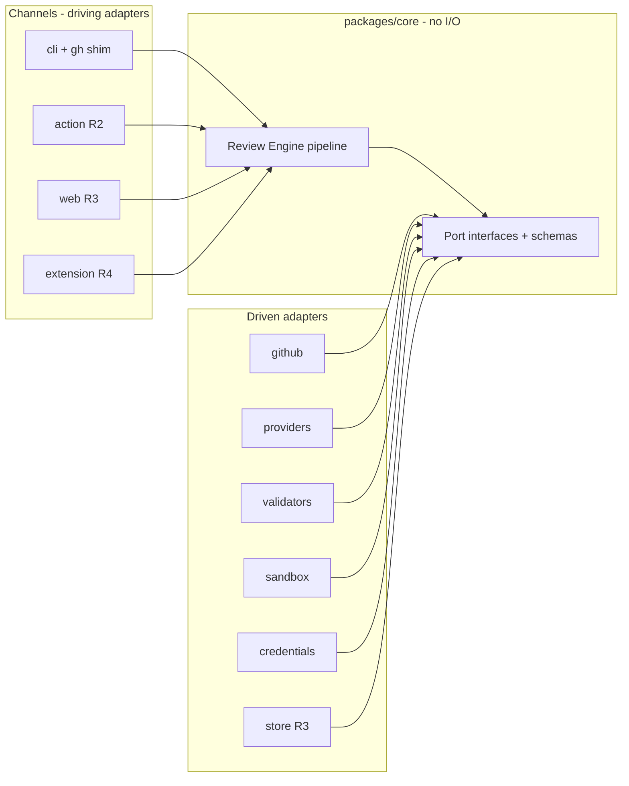
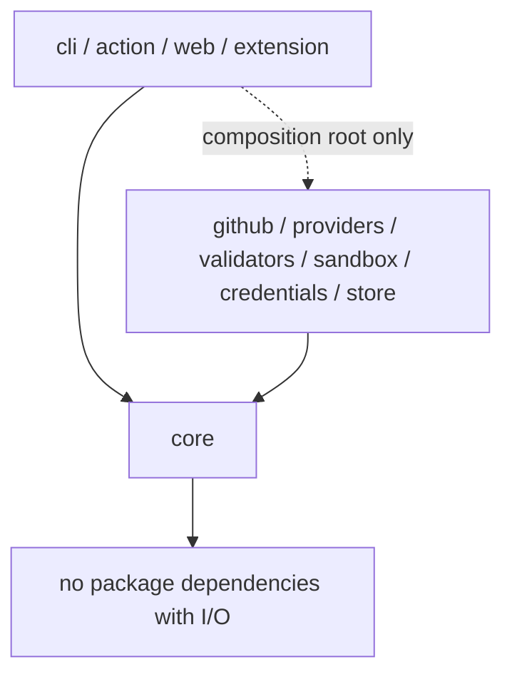
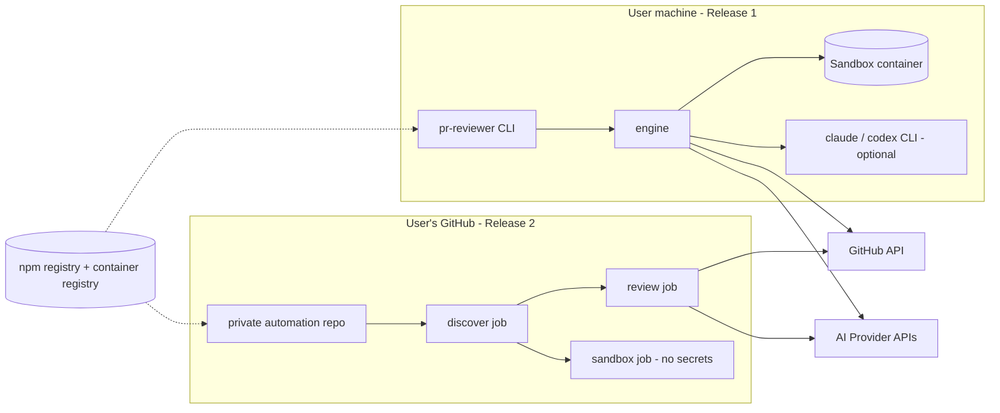

# Architecture Spine — PR Reviewer

Terms (Review Engine, Channel, Review Run, Finding, Report, Layer Status, Overall Status, Coverage, Mandatory Layer, AI Provider, Credential, Configuration, Watch Scope, Sandbox, Publish) are used exactly as defined in the PRD §3 Glossary.

## Design Paradigm

**Hexagonal (ports & adapters)** with the Review Engine as a **pipes-and-filters** pipeline at its centre.

- **Core** (`packages/core`): the pipeline, schemas, gate, fingerprinting, and the port interfaces. No I/O.
- **Driven adapters** implement core ports: `github`, `providers`, `validators`, `sandbox`, `credentials`, `store` (Release 3).
- **Driving adapters** are the Channels: `cli` (with the `gh` extension shim), `action` (Release 2), `web` (Release 3), `extension` (Release 4). Each has one composition root that wires adapters into the engine.



## Invariants & Rules

### AD-1 — Core is I/O-free and isomorphic

- **Binds:** `packages/core`; FR-6a, NFR-7, NFR-8; Extension Standalone mode (FR-37).
- **Prevents:** a Node-only or effectful engine that can't run in the browser extension or be tested deterministically.
- **Rule:** `core` imports no Node built-ins, no `fetch`, no `process`/env, no timers beyond what ports provide, and no third-party package with I/O. Neither `core` nor its runtime dependencies generate code at runtime (`eval`, `new Function`); the schema library runs in its eval-free mode. Every effect goes through a port passed in at construction. A lint rule enforces the import ban, and a test loads `core` under a CSP without `unsafe-eval`.

### AD-2 — Dependency direction

- **Binds:** all packages.
- **Prevents:** cycles, adapters coupling to each other, Channels bypassing the engine.
- **Rule:** dependencies point inward only, as drawn below. An adapter never imports another adapter. A Channel imports adapters only in its composition root and calls review behaviour only through the engine.



### AD-3 — One fixed pipeline; only the gate decides status

- **Binds:** Review Engine; FR-2..FR-8, FR-19, NFR-8.
- **Prevents:** Channels assembling different Reports from the same inputs; ad-hoc status logic.
- **Rule:** every Review Run executes these stages in order, each taking and returning an immutable `RunContext`:
  `resolveConfig → fetchContext → detect → plan → execute → redact → review → normalize → dedupe → gate → assemble` — then optional `publish` as a separate call. `execute` runs the deterministic and file-only Validators (including secret scanning) in parallel under per-Validator timeouts and a concurrency limit. `redact` removes secret values from everything that may reach an AI Provider. `review` is the only stage that calls an AI Provider; it receives the redacted context plus the deterministic Findings. Only `gate` computes Overall Status, except `CANCELLED`, which the run controller sets when the PR head moves mid-run. A Channel may stop after `assemble` (no Publish) but may not skip, reorder, or replace stages.

### AD-4 — Schemas live in core and are the only shape

- **Binds:** Configuration, Finding, Report, ValidatorResult, ReviewRequest/ReviewResponse; FR-8, FR-24, FR-32.
- **Prevents:** CLI JSON, Web App, extension, and Validators drifting into different shapes.
- **Rule:** each shape is defined once as a runtime schema in `core`; TypeScript types are inferred from it and JSON Schema is generated from it and published with each release. Every persisted or transmitted artefact carries `schemaVersion`. Anything crossing a port boundary (Validator output, Sandbox output, AI output, repo config) is parsed with the schema before use; parse failure is a Layer Status `ERROR`, never a partial result.

### AD-5 — Validator contract

- **Binds:** `packages/validators`, Sandbox; FR-3, FR-4, FR-39, FR-40, NFR-7.
- **Prevents:** Validators doing their own I/O, inventing statuses, or running PR code outside a Sandbox.
- **Rule:** a Validator is `{ id, version, layers[], supports(ctx), needsSandbox, inputs(ctx), run(ctx, ports) → ValidatorResult }`, registered in the core registry. `inputs` declares the file scope it reads (used for cache keys, AD-12). `needsSandbox: true` Validators run only through the Sandbox port; if no Sandbox is available, the engine records `SKIPPED (no Sandbox)` without calling them. Statuses are the seven Layer Statuses only. A tool crash is `ERROR`; a problem in the PR is a Finding.

### AD-6 — Context retrieval split

- **Binds:** `fetchContext`, Sandbox; FR-2, FR-39, FR-40. Resolves PRD OQ-8 (clone vs API-only).
- **Prevents:** laptop runs needing a clone, and untrusted checkouts outside a Sandbox.
- **Rule:** outside the Sandbox, all PR context (metadata, diff, base and head file contents, existing reviews and comments, check results) comes from the GitHub API through `GitHubPort`. A git checkout of the PR (shallow, at head, plus merge-base) exists only inside the Sandbox.

### AD-7 — Sandbox boundary

- **Binds:** `packages/sandbox`, Auto-Review workflow (R2), Web App runs (R3); FR-39, NFR-1.
- **Prevents:** PR code reaching Credentials, tokens, or trusted caches.
- **Rule:** the Sandbox is an ephemeral container (Docker or Podman, auto-detected) from a pinned toolchain image built in this repo. Two phases: `install` (network limited to package registries) then `analyze` (no network). Only the checkout and a scratch dir are mounted; no host credentials, no Credential env vars, no container socket. Its only output is JSON on stdout, parsed per AD-4. In GitHub Actions it is a separate job with `permissions: {}` and no secrets; its artefacts are untrusted input to the publishing job.

### AD-8 — AI calls are single, structured, tool-less

- **Binds:** `packages/providers`; FR-6, FR-6a, FR-6b, FR-9, FR-9a, FR-10, FR-11.
- **Prevents:** agentic behaviour, provider-specific Finding shapes, and secrets or prompt-injected instructions acting through the AI.
- **Rule:** `ProviderPort.complete(ReviewRequest) → ReviewResponse`; one request per call, the response is JSON matching the Finding schema. HTTP adapters: `anthropic`, `openai-compatible` (covers OpenAI, OpenRouter, Ollama, Azure OpenAI, and FR-9a custom endpoints). CLI adapters: `claude-code`, `codex` — they spawn the vendor's own binary in a fresh empty temp directory (outside any git repository) with all tools disabled, project settings, hooks, MCP servers, and agent instruction files not loaded, a minimal environment with no GitHub or other Credentials (the vendor's own login store stays reachable), the request on stdin, and schema-constrained JSON output. The only exception to the Credential-free environment is the Auto-Review subscription opt-in (PRD FR-10), where exactly the vendor's own CLI token variable is passed. The adapter checks the vendor CLI's version at start-up and refuses versions that lack the isolation flags it relies on. Each adapter declares the Channels it is allowed in (PRD FR-10 matrix); the engine refuses a provider outside its Channels, and fallback skips refused providers rather than substituting silently. Core re-validates every response (schema, file exists, line exists in Head Commit) and drops the rest, counting them. AI output never sets a verdict or status; only `gate` does.

### AD-9 — Single writer to GitHub

- **Binds:** `publish` stage, `GitHubPort`; FR-6a, FR-17..FR-21.
- **Prevents:** side-channel posts from Validators, providers, or Sandbox output.
- **Rule:** only the engine's `publish` call writes to GitHub, through `GitHubPort`. Other ports receive read-only GitHub access or none. `GitHubPort` has no operation that approves or merges. Inline comments attach only to right-side lines inside the PR's diff hunks (the mapping kept from `review.mjs`); anything else goes in the summary. Published text is sanitised in `publish` (mentions neutralised, links allow-listed, HTML stripped). Auto-Review never sends `REQUEST_CHANGES`; review-requested PRs default to a pending review (FR-20a); if the user already has a pending review on the PR, the product adds to it rather than creating a second.

### AD-10 — Credentials are references, values are opaque

- **Binds:** `packages/credentials`, Configuration, logging; FR-15, NFR-2.
- **Prevents:** Credential values in Configuration, Reports, logs, prompts, or Sandbox.
- **Rule:** Configuration holds named references (`github`, `provider:<id>`), never values. `CredentialPort` resolves them from OS keychain, environment, or a vendor CLI (e.g. `gh auth token`) into a `Secret` object whose string and JSON forms are redacted; the raw value is read only inside the adapter that sends it. The logger redacts every resolved secret value.

### AD-11 — Idempotency and self-recognition by marker

- **Binds:** `publish`, Auto-Review discovery; FR-19, FR-20a, FR-20b.
- **Prevents:** duplicate reviews, editing human comments written by the same GitHub user, state stores drifting from GitHub.
- **Rule:** `idempotencyKey = sha256(owner/repo, prNumber, headSha, configHash, engineMajor, reviewerLogin)`. Every published summary and inline comment ends with the hidden marker `<!-- pr-reviewer v1 key=<idempotencyKey> fp=<fingerprint|summary> -->`. A comment or review is the product's own only if it carries the marker **and** its author is the current Reviewer Identity; a marker in anyone else's comment is ignored. Before publishing, the engine reads its own markers (including the user's pending review); a matching key means skip. Dismissal feedback (FR-20b) suppresses re-posting a fingerprint but never changes the gate.

### AD-12 — Fingerprints and cache keys

- **Binds:** `dedupe`, caching, incremental re-review; FR-7, FR-19, NFR-11. Resolves PRD OQ-8 (fingerprinting, "unchanged inputs").
- **Prevents:** duplicate Findings across line shifts and across Validators; stale cache reuse.
- **Rule:**
  - `fingerprint = sha256(ruleId, repo-relative POSIX path, whitespace-collapsed anchor lines plus up to 2 context lines each side, source family)` — line numbers never included. `Finding.id = fingerprint`. Cross-source dedupe merges equal fingerprints, then same category with overlapping ranges, keeping the strongest evidence (deterministic over AI).
  - Validator cache key = `sha256(validator id+version, tool version, the Configuration subset it reads, git blob/tree SHAs of its declared inputs)`. AI cache key = `sha256(provider, model, prompt-template version, redacted request)`. Reuse only on exact match. Caches are namespaced per user and per repository. The gate always evaluates the whole PR.

### AD-13 — Configuration resolution

- **Binds:** `resolveConfig`; FR-1, FR-13, FR-14. Resolves PRD OQ-6.
- **Prevents:** a repository redirecting Credentials or data, PRs disabling their own checks, hardcoded values.
- **Rule:** order is product defaults → user config → repo config → per-run overrides. User config: `$XDG_CONFIG_HOME/pr-reviewer/config.yml` (`%APPDATA%\pr-reviewer\config.yml` on Windows). Repo config: `.github/pr-reviewer.yml`, read from the PR's **base** branch. Both YAML with `version: 1`. The repo schema is a strict allow-list (Review Rules, include/exclude paths, thresholds, comment limits, extra Validators); forbidden or unknown keys are ignored and reported. Mandatory Layers and locked settings come only from user config. Product defaults contain no hosts, repos, orgs, or URLs beyond the public GitHub API default, which is overridable.

### AD-14 — Auto-Review is stateless; GitHub is the store

- **Binds:** `packages/action` (R2); FR-26..FR-29a. Resolves PRD OQ-8 (state location, public vs private).
- **Prevents:** a separate state file diverging from reality; PR data in automation logs or state.
- **Rule:** the automation lives in a **private** repository in the user's account, created by setup, on a 30-minute schedule plus manual dispatch. Each run: a `discover` job (GitHub search with the user's token; reads AD-11 markers to skip reviewed Head Commits) → per-PR `sandbox` job (AD-7) and `review` job (engine, Credentials, publish). No PR content, Finding, or code is written to logs, artefacts beyond the run, or the repository. Health problems are reported as one issue per cause in the automation repository (FR-29).

### AD-15 — Report shape

- **Binds:** `assemble`, all Channels, JSON output; FR-8, FR-17, FR-24, FR-32, NFR-10. Resolves PRD OQ-8 (Report schema).
- **Prevents:** Channels inventing their own report fields or status meanings.
- **Rule:** a Report (schemaVersion 1) has: `run{id, idempotencyKey, repo, pr, baseSha, headSha, mergeBaseSha, configHash, engineVersion, channel, startedAt, finishedAt}`, `overallStatus`, `coverage[]`, `technologies[{project, language, framework?, version?, confidence, evidence[]}]`, `layers[{layer, validator, status, reason?, tool?, toolVersion?, durationMs}]`, `findings[]` (Validation Capability Spec §23 fields plus `fingerprint`), `gate{result, failedRules[]}`, `ai{provider, model, usage{input, output}, costEstimate?}`, `rulesChecklist[]`, `publish?{reviewUrl, pending, commentCount}`, `audit{}`. Channels render only from this object.

### AD-16 — Channels are thin

- **Binds:** `cli`, `action`, `web`, `extension`, `gh` shim; FR-22..FR-38.
- **Prevents:** review logic forking per Channel.
- **Rule:** a Channel owns I/O, UX, and its composition root, nothing else. The `gh` extension is a shim that invokes the published CLI. Remote engines (the Web App server and the CLI companion) expose one Engine API — an HTTP + server-sent-events contract whose request, progress, and Report shapes are defined by `core` schemas — and the extension's Connected mode speaks only that contract. The CLI companion listens on loopback only, requires a pairing token, and rejects other Origin/Host values. The **isomorphic set** — `core`, `github`, the HTTP provider adapters, and the file-only Validators (secret scanning, manifest analysis) — obeys AD-1's bans; the extension's Standalone mode bundles exactly this set and runs it in the side panel page, never in the MV3 service worker, which the browser stops when a response takes longer than 30 seconds.

### AD-17 — Errors, logging, and status

- **Binds:** all packages; FR-4, NFR-4, NFR-10.
- **Prevents:** mixed error semantics and leaked data in logs.
- **Rule:** adapters return typed results; infrastructure failures become Layer Status `ERROR` or `TIMEOUT` with a reason, never Findings. Code never throws past a stage boundary except for programmer errors. Logs are structured JSON lines through one logger with redaction (AD-10) and no source code or Finding text above `debug`.

### AD-18 — Usage ledger for ceilings

- **Binds:** `review` stage, all Channels; FR-12.
- **Prevents:** each Channel keeping its own idea of monthly spend, or storing PR data to count it.
- **Rule:** monthly ceilings read and update a `UsageLedgerPort` that stores numbers only (month, tokens, cost estimate). CLI: a file in the user config directory. Auto-Review: a repository variable in the automation repo. Web App: its store, per user. The engine checks the ledger before every AI call.

### AD-19 — Network destinations

- **Binds:** all adapters; NFR-3, FR-6b.
- **Prevents:** code or data reaching a destination the user didn't choose.
- **Rule:** the product connects only to: the configured GitHub API host, the chosen AI Provider endpoints, the configured vulnerability-advisory endpoint (sent package names and versions only), and package registries (Sandbox `install` phase only). Telemetry is a port whose default implementation does nothing. Dependency auditing is a file-only Validator that reads manifests and lockfiles and queries the advisory endpoint through a port.

### AD-20 — Brownfield disposition

- **Binds:** repository root; FR-1, FR-16a.
- **Prevents:** the old tool and the new one diverging, or repo-specific values surviving.
- **Rule:** `review.mjs`, `test.mjs`, the repo-specific rules file, and the manual workflow stay unchanged until the CLI reaches parity (Epic 2, Story 2.7), then are removed in that story. Kept and ported: diff-line mapping (AD-9), the untrusted-input stance (AD-8), never-approve (AD-9). Dropped: the AI's own verdict and risk fields (only `gate` decides). The old skip list becomes the default exclude paths in product defaults (overridable). The replacement workflow writes no Findings to step summaries or retained artefacts.

## Consistency Conventions

| Concern | Convention |
| --- | --- |
| Package names | `@pr-reviewer/<package>`; CLI binary `pr-reviewer` (pending product name, PRD OQ-5) |
| Files | kebab-case `.ts`; one Validator or adapter per directory with its own tests |
| Identifiers | Validator ids `<tech>.<tool>` (e.g. `ts.tsc`, `angular.eslint`); rule ids from the tool, prefixed by source (`eslint/no-unused-vars`, `ai/perf-lookup-in-loop`) |
| Time and paths | ISO-8601 UTC timestamps; repo-relative POSIX paths everywhere |
| Hashing | sha256, lowercase hex |
| Enums | Layer Status, Overall Status, severity (`BLOCKER`…`INFO`), confidence (`HIGH`/`MEDIUM`/`LOW`) as UPPER_SNAKE strings from the schemas only |
| Errors | `Result<T, AppError>` at port boundaries; `AppError{code, message, retryable}`; no thrown errors across ports |
| Config keys | camelCase in YAML; every key documented in the generated JSON Schema |
| Exit codes (CLI) | 0 `PASSED` or `PASSED_WITH_WARNINGS` (1 for warnings with `--strict`), 2 `FAILED`, 3 `INCOMPLETE`, 4 `ERROR`, 5 `CANCELLED`, 64+ usage errors |
| Testing | unit tests beside code; a recording provider and recorded GitHub fixtures for engine tests; no test calls live AI or GitHub by default |
| Commits | conventional-style messages; no AI-tool attribution |

## Stack

| Name | Version |
| --- | --- |
| Node.js | 26 LTS for development; CLI `engines` ≥ 22 (all supported LTS lines) |
| TypeScript | 7.0.x (`module: nodenext`) |
| pnpm (workspaces) | 12.x |
| Vitest | 5.x |
| Zod (schemas + `z.toJSONSchema`, JSON Schema draft 2020-12) | 4.x |
| Sandbox runtime | Docker or Podman (auto-detected); `--network none` for analyze |
| Claude Code CLI (optional provider) | version with `--bare`, `--tools`, `--json-schema` |
| Codex CLI (optional provider) | version with `--output-schema`, `--disable shell_tool`, `--ignore-rules` |
| Browser extension | Chrome Manifest V3, Side Panel API (Chrome ≥ 114) |

## Structural Seed

```text
pr-reviewer/
  packages/
    core/          # pipeline, schemas, gate, fingerprint, ports, registry — no I/O
    github/        # GitHubPort: REST/GraphQL read, publish, markers
    providers/     # anthropic, openai-compatible, claude-code, codex (+ gemini, bedrock later)
    validators/    # detection + ts, angular, react, secrets, deps; reuse-existing-results
    sandbox/       # SandboxPort container impl + toolchain image (Dockerfile)
    credentials/   # keychain, env, vendor-CLI resolvers
    cli/           # npm CLI channel + composition root
    gh-extension/  # shim invoking the CLI
    action/        # R2 Auto-Review workflows + setup
    web/           # R3 server + UI
    extension/     # R4 MV3 extension
  schemas/         # generated JSON Schemas (published)
  docs/
```



## Capability → Architecture Map

| Capability / Area | Lives in | Governed by |
| --- | --- | --- |
| FR-1, FR-2 PR reference and context | core `fetchContext`, `github` | AD-6, AD-13 |
| FR-3 detection | `validators/detection` | AD-5 |
| FR-4, FR-5 layered validation, reuse results | core `execute`, `validators` | AD-3, AD-5, AD-12 |
| FR-6, FR-6a, FR-6b AI review, no tools, redaction | core `redact`, `providers` | AD-8 |
| FR-7 dedupe and gate | core `dedupe`, `gate` | AD-3, AD-12 |
| FR-8, FR-24 Report and JSON | core `assemble` | AD-4, AD-15 |
| FR-9..FR-12 providers, fallback, cost | `providers`, core | AD-8 |
| FR-13..FR-16a configuration, credentials, setup, migration | core `resolveConfig`, `credentials`, `cli` | AD-10, AD-13 |
| FR-17..FR-21 publishing | core `publish`, `github` | AD-9, AD-11 |
| FR-22..FR-25a CLI | `cli`, `gh-extension` | AD-16 |
| FR-26..FR-29a Auto-Review | `action` | AD-14, AD-7 |
| FR-30..FR-35 Web App | `web` | AD-16, AD-10 |
| FR-36..FR-38 extension | `extension` | AD-1, AD-16 |
| FR-39, FR-40 Sandbox | `sandbox`, `validators` | AD-5, AD-7 |
| NFR-2, NFR-10 secrets, audit | `credentials`, logger, `assemble` | AD-10, AD-15, AD-17 |

## Deferred

- **Web App internals** (job queue, persistence engine, UI framework): decided at Release 3; bound only by AD-1..AD-4, AD-10, AD-16.
- **Extension internals** (UI framework, storage choice per token): decided at Release 4; bound by AD-1, AD-16 and PRD §4.8.
- **Gemini and Bedrock adapters:** Release 1.x; they implement the AD-8 port unchanged.
- **Python and Java Validators:** Release 1.x/2.x; they follow AD-5.
- **Sandbox registry allow-listing mechanism** (proxy vs runtime network policy): an implementation choice inside AD-7.
- **Keychain library choice:** inside `credentials`; AD-10 binds the behaviour.
- **SARIF export:** post-v1 (PRD FR-8 assumption); would be another rendering of the AD-15 Report.
- **GitHub Enterprise Server testing:** best-effort; the API base URL is already configurable (AD-13).
- **Hosting and operations of a public instance:** not in v1 (PRD non-goal); nothing in this spine assumes a central service.
- **GitHub token type for Auto-Review** (PRD OQ-3): decided in Epic 5, Story 5.1 (Release 2), bound by FR-26's least-privilege and expiry rules.
- **Auto-Review CI-minute budget tuning:** the `discover` job must finish in under a minute on the smallest runner; setup computes and shows the expected monthly usage (FR-29a). Exact interval tuning happens in Epic 5.
- **Product name** (PRD OQ-5): package scope, binary, and config paths follow it; renaming is mechanical.
